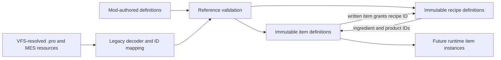

# Item prototypes and schematics

## Evidence and scope

This investigation used the Arcanum-RS VFS with CE-mode resource precedence against the installed game, with no extra mod selected. Individual archive mounts supplied comparison copies. A temporary, bounded inspection of five VFS-resolved prototype files checked their headers and fields against the CE reader. CE source revision `fb721982` supplies implementation evidence. The Windows executable and save files were unnecessary for these static checks. The game was never launched.

The installed tree includes loose overrides. References to **installed data** identify the winning resource in this tree. **CE behavior** describes a path observed in the source. The Fortifier symptom is a **user observation**. The Rust model below is a **proposal**.

## Format inventory

| Resource | Data and references |
| --- | --- |
| `proto/*.pro` | Versioned binary object prototype records. Sampled item types include Food, Written and Weapon. A record identifies itself and carries common object fields, common item fields and a type-specific tail. |
| `rules/schematic.mes` | Numbered recipe groups. Values refer to text IDs, artwork IDs and item prototype lookup IDs. The installed loose copy wins over `Arcanum3.dat`, `Arcanum4.dat` and `Arcanum5.dat`. |
| `mes/schematic_text.mes`, `mes/tech.mes` | Schematic titles and descriptive prose, plus discipline and progression labels in the tech table. Recipe components come from the rules table. |
| `mes/description.mes`, `mes/gamedesc.mes` | Object descriptions. CE dispatches IDs below 30000 to the first table and module IDs from 30000 to the second. Identified and unidentified versions can have different keys. The sampled base description table resolves to `Arcanum5.dat`. |
| `oemes/oname.mes`, `oemes/gameoname.mes` | Internal object names. CE can merge module entries into the base table. For example, Wine's internal name ID is 3608, distinct from its display description ID 10093. |
| `mes/item_effect.mes`, `mes/gameitemeffect.mes`, `rules/effect.mes` | The first two are base and module effect-description tables selected by a separate item field. `rules/effect.mes` supplies effect definitions. Prose and effect rules are distinct from the prototype's spell-slot references. |
| `art/item/item_{ground,inven,paper,schematic}.mes`, `art/interface/interface.mes`, `*.art` | Artwork lookup tables and assets. Item disposition selects a table; the recipe drawing uses an interface index. |
| `rules/invensource.mes` | Stocking references to basic prototype IDs. The winning `data/rules/InvenSource.mes` includes 10067 in several source definitions. This establishes an ordinary stock route for Varham's Aqua Vitae. |

### Binary definitions, identity and runtime objects

- The five sampled `.pro` records use little-endian version **119**. After the 32-bit version comes a 24-byte serialized object ID. Its blocked kind selects the prototype layout. Next come the prototype's own 24-byte ID (numeric kind 1 in these files), a 32-bit object type, a type-sized bitmap and the ordered field payload. In the samples the numeric ID is at byte 36 and object type at 52. The bitmap occupies four 32-bit words in all five samples. These offsets describe the input format only.
- Fields are ordered by common object, item and subtype groups. A scalar integer occupies four bytes. Other fields use a presence byte and a type-specific payload when present. The Weapon sample has sparse lower and upper damage arrays. CE's array format carries element size and count, an additional header word, element data and a serialized index bitset. A later reader must validate lengths and field types against the declared version and subtype. File length and field positions beyond the header vary with optional data.
- The prototype file's numeric prefix agrees with its serialized ID in all samples. In the built-in lookup path, CE translates a basic prototype ID `n` into numeric object ID `n + 20`. The four Fortifier-related records and the Weapon sample confirm this mapping. Built-in generation uses number ranges to choose an initial object type and typically initializes the description to the basic number. The serialized type and description field are independently stored. Treat filename prefixes as discovery hints and make cross-domain conversion explicit.
- CE's `proto_init` can generate missing built-ins, sourcing some defaults from compiled initialization code in `proto.c`, then opens the discovered `proto/*.pro` files. The sampled definitions are existing loose files. The fallback initializer can explain fields, but the resolved binary takes precedence as evidence for this installation. How to supply missing definitions without a prepopulated loose tree remains an importer question.
- A serialized object instance carries a prototype ID, its own object ID, and a different body for overridden fields. CE resolves the prototype ID to a runtime handle and reads unchanged fields from that definition. Inventory objects are instances listed under their owner. Stocking or a script can instantiate one from a basic ID. Recipe slots and written schematic items are confirmed definition-to-definition references. Prototype fields can also hold typed object IDs, but no general item-to-item inheritance graph was established.
- Stored fields include display/unknown description keys, an internal name key, art IDs, item flags, raw weight and worth, HP, material, discipline, signed magic/technology complexity and spell slots. Subtype fields add properties such as weapon damage arrays or a written object's text index. Runtime calculations include identification-dependent worth, quantity- and magic-adjusted weight, effective expertise, artwork state and inventory ownership. Raw values below preserve legacy units and each property's meaning must be validated before conversion.

### Schematic groups and presentation

At recipe base ID `r`, the seven consecutive records `r+0` through `r+6` are name text, description text, interface drawing, component slot 1, component slot 2, product and product count. Recipe IDs commonly advance in steps of ten. CE uses `2000..3999` for learned recipes, where the discipline is derived from the block of 200. The degree helper uses `1990 + 200 × discipline + 10 × degree`. Found recipes in the sampled `4000..5999` section derive their discipline in CE from the first product prototype. The `6000 + 10 × discipline` records serve as title pages in the UI. These numbering conventions are legacy import rules.

Item lists can contain multiple ordered basic IDs. For example, group 2450 has alternatives for the second slot and three corresponding products. CE fills unused positions of its three-slot arrays by repeating the last ID. It looks up each ingredient independently, then uses the first ingredient's matched index for the output if that index is nonzero, and the second ingredient's index otherwise. Only the observed mappings should be imported. Unknown combinations should surface as diagnostics.

Item art IDs pack a type, art number, subtype and disposition with other variant/state information. In the sampled item path CE uses `number + 20 × (subtype + 50 × type)` as an MES key and has an extra armor-coverage adjustment. Wine and Aqua Vitae share a ground bottle graphic but have different inventory art. All three item assets resolve to `Arcanum2.dat`. Recipe drawing 696 in the interface table resolves to `art/interface/s_fortifier.art` in `Arcanum1.dat`. The ingredient picture comes from the component prototype's item art, with a weapon/armor schematic-art lookup before the inventory fallback. A common asset or plausible tooltip does not establish item identity.

## Fortifier investigation

### Confirmed from installed data

The Fortifier recipe is **4220**. The winning loose table and the separately mounted copies in `Arcanum3.dat`, `Arcanum4.dat` and `Arcanum5.dat` agree on all seven entries.

| Recipe key | Meaning | Value |
| --- | --- | --- |
| 4220, 4221 | Title and description keys in `mes/schematic_text.mes` | 564, 565 |
| 4222 | Interface drawing key | 696 |
| 4223 | First ingredient | Wine, basic ID **10093** |
| 4224 | Second ingredient | Varham's Aqua Vitae, basic ID **10067** |
| 4225, 4226 | Product and count | Fortifier, basic ID **10119**, quantity **1** |

| Item | Basic ID | Serialized ID and winning path relative to `data` | Stored fields |
| --- | ---: | --- | --- |
| Varham's Aqua Vitae | 10067 | 10087, `proto/010087 - Food.pro` | Identified and unknown description 10067, Chemistry (1), complexity −10, raw weight 5, worth 2, spell slot 1 = 173. Inventory art key 4032, `i_cough_syrup.art`. |
| Wine | 10093 | 10113, `proto/010113 - 3608 Bottle of Alcohol.pro` | Description 10093, internal name 3608, Chemistry (1), complexity 0, raw weight 20, worth 10, spell slot 1 = 172. Inventory art key 4031, `i_bottle_of_wine.art`. |
| Fortifier product | 10119 | 10139, `proto/010139 - Food.pro` | Description 10119, Chemistry (1), complexity −55, raw weight 10, worth 20, spell slot 1 = 195. Inventory art key 4061, `i_fortifier.art`. |
| Fortifier schematic item | 14079 | 14099, `proto/014099 - Written.pro` | Description 14079, written subtype 5, text-start field 4220. The text-start field supplies the recipe ID when CE teaches the schematic. |

The VFS-selected base and module description tables contain one relevant label, **Varham's Aqua Vitae** at 10067. The stock entries in `InvenSource.mes` refer to that same basic ID. The stock prototype stores the same description ID for the identified and unknown cases. No separate item named only “Aqua Vitae” was found in those winning tables. An effect comment using the shorter name does not identify another prototype. The user's particular inventory instance was not inspected.

### Confirmed CE matching and expertise

1. The schematic UI checks the **primary crafting actor's** direct inventory list. It resolves each recipe ID to a prototype and calls `sub_462540` with flags `0x7`. The same matching flags are used on the combine path.
2. A candidate needs the same resolved prototype handle as the recipe target and the same numeric **description** field as that prototype. CE excludes wear slots 1000–1008 and an item marked destroyed by its current art ID. Hotkey slots 2000–2009 can match and are a fallback after regular slots. The matcher performs no comparison of visible text, internal name, spell, or artwork filename. It does not recursively search other inventories.
3. Expertise is a separate check against the chosen component prototype's discipline and the negation of its signed complexity. For Fortifier that means effective Chemistry of at least **10** for Aqua Vitae and **0** for Wine. The product's complexity of −55 supplies no crafting threshold for this recipe. Effective level comes from the actor's degree, current intelligence and effects. Unmodified Novice provides 10, with the degree table requiring intelligence 5 to retain that level.
4. UI readiness reports lack of expertise ahead of missing items. Low expertise can gray the component art even if the inventory match succeeded. The source distinguishes this from the missing-item indicator. The combination code consumes the matched items (one unit when the input is ammo) and creates the stated count of the selected result.
5. A map object patch can override the description ID via `known_name` without changing the prototype. A script transformation can create a replacement instance from another basic prototype and transfer it to the old owner. Either mechanism can affect the matcher. The sampled Aqua Vitae prototype has no stored script array. Its particular world instance could still be affected by map or script actions elsewhere. There is no evidence here of either mechanism acting on the reported item. Identification changes alone are not a matcher condition.

### What the evidence establishes

The reported symptom is that CE shows Aqua Vitae as unavailable and disables crafting while the player has an item they call Aqua Vitae. The four static recipe sources agree with the resolved Wine and Varham prototypes. No Fortifier data mismatch or specific CE defect was established. The distinction between missing item and missing expertise is material. A low effective Chemistry level explains gray art without an inventory failure. A different actor's inventory, a nonmatching prototype or overridden description, or a destroyed or equipped candidate can explain a failed inventory match. These are conditional explanations, not findings about that session.

To establish the cause, capture the exact CE build and active resource sources, the selected crafting actor and exact indicator or click feedback, the actor's effective Chemistry and both slots' readiness, and each relevant instance's owner/list membership, resolved prototype ID, current and base description IDs, inventory slot and destroyed-art flag. Comparing that snapshot to each matcher predicate would isolate the first failing condition. No gameplay or save changes are needed for the static conclusion.

A separate, confirmed example of data disagreement is Potion of Paralysis: the sampled schematic description names Mushrooms and Varham's Aqua Vitae, while recipe 4240 specifies Poison (10075) and Wine (10093). This demonstrates why prose should be preserved as text and validated separately from ingredient references.

## Proposed native Rust model

| Proposed type | Responsibilities |
| --- | --- |
| `ItemDef` | Typed, namespaced `ItemId`; localized display and optional unidentified/effect text references; typed base properties with documented units; artwork by role; and an `ItemKind` payload for category-specific data. A written item can explicitly grant a `RecipeId`. An optional effect reference can point to validated native effect content. |
| `RecipeDef` | Typed `RecipeId`; title, description and optional illustration; ingredient slots with positive quantities and explicit item IDs or ordered alternatives; result item/count with explicit alternate outcomes; discipline and expertise requirements; discovery as a grant or a discipline progression rule. |
| Future `ItemInstance` | Separate world identity, reference to an immutable item definition, owner/location, condition, quantity and instance-specific state. Runtime crafting should explain eligibility separately from expertise. No instance type is introduced here. |

Native references should be resolved in a validation step against the active package set. Ingredient membership should use explicit item identity or declared alternatives. A proven legacy restriction on a particular variant can become an explicit eligibility rule, with a diagnostic. Localized display strings remain presentation data. A definition's provenance records the source package and resource and, for an imported row or field, its legacy location. It can be reported without entering gameplay state. Unknown legacy fields stay at the import boundary.

Reserve an `arcanum` namespace for imported definitions, with reviewed stable aliases such as `arcanum:item/iron-ore`. A package might define `industrial-expansion:item/steam-regulator` and a recipe under the same namespace. Keep separate legacy maps for basic prototype number, serialized numeric ID, recipe number, and text resource plus key. A stable fallback alias based on a legacy ID is viable until human-readable aliases are curated. The `+20` translation and legacy discipline numbering belong in import validation. Use local package indexes initially. A global registry is outside this milestone.

### Authoring and overrides

- TOML is a good prototype for hand-authored definitions because the existing manifests use it and recipes benefit from comments. JSON suits generated interchange and schema tooling. Evaluate a small equivalent item and recipe in both before selecting a schema. The native types should accept validated inputs from either source.
- Use package dependency declarations for cross-package references. Adding an item creates a new namespaced definition. An explicit override can target an existing definition by ID and retain that ID for dependents. Preserve provenance of the winner and superseded definitions. Prefer whole-definition replacement initially, with an explicit conflict diagnostic and deterministic ordering. VFS overrides continue to replace bytes at a path, including binary prototype or MES files.
- The minimum useful invention package needs an item with text and art (or references to existing assets), an output recipe with explicit inputs, a requirement in an existing discipline, and a grant or unlock path. A new discipline additionally needs progression and presentation definitions. A genuinely new behavior needs an engine-supported effect; a new label, art asset or recipe alone does not define gameplay behavior.

## Implementation boundary and verification

Milestone 4 is documentation only. The bounded prototype probe validated sampled fields but did not establish every subtype, version, default-generation path or recipe alternative. A runtime matcher would also require evidence that distinguishes instance eligibility from expertise.

The next milestone should decode **version 119 headers and one Food prototype subset** and **one explicitly selected schematic group** from a caller-supplied VFS. Validate recipe text, art, ingredient and result references, and emit structured diagnostics and provenance. Use synthetic fixtures for malformed headers, unknown IDs, truncated fields and alternative handling. Fortifier serves as an optional read-only integration sample. Leave crafting execution, inferred repairs, a final authoring schema, general object decoding and save loading outside the slice.

The existing Rust formatting, lint, build and 37 unit tests passed. The installed-data `vfs-smoke` integration test also passed. Representative VFS checks used the installed loose and archive sources without launching the game.

### Primary reference locations

- CE `src/game/proto.c` (`proto_init`, `sub_468660`, `sub_468860`, and the four `BP_*` initializers), `descriptions.h`, `obj_id.h`, `obj_id.c`.
- CE `src/game/obj.c` (`obj_read`, `obj_proto_read_file`, `obj_inst_read_file`, `obj_create_inst`, `obj_field_fetch`, `object_proto_enumerate_fields`), `obj_private.c` and `sa.c` for field and array serialization.
- CE `src/ui/schematic_ui.c` (`tech_from_schematic`, `schematic_ui_info_get`, `schematic_ui_parse_items`, `schematic_ui_draw_component`, `schematic_ui_process`) and `src/game/tech.c` (`tech_degree_level_get`, `tech_learn_schematic`, `tech_schematic_get`).
- CE `src/game/item.c` (`sub_462540`, `item_weight`, `item_worth`), `item.h`, `invensource.c`, `map.c` (`map_apply_obj_patch`), `script.c` (`SAT_TRANSFORM_ATTACHEE_INTO_BASIC_PROTOTYPE`).
- CE `src/game/description.c`, `oname.c`, `item_effect.c`, `a_name.c` and `first_party/tig/src/art.c` for text and art resolution.
