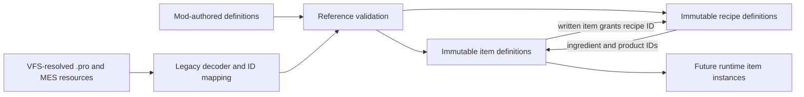

# Item prototypes and schematics

## Evidence and scope

This investigation used the Arcanum-RS VFS with CE-mode resource precedence against the installed game, with no extra mod selected. Individual archive mounts supplied comparison copies. A temporary, bounded inspection of five VFS-resolved prototype files checked their headers and fields against the CE reader. CE source revision `fb721982` supplies implementation evidence. The Windows executable and save files were unnecessary for these static checks. The game was never launched.

The installed tree includes loose overrides. References to **installed data** identify the winning resource in this tree. **CE behavior** describes a path observed in the source. The Fortifier symptom is a **user observation**. The Rust model below is a **proposal**.

## Format inventory

| Resource | Data and references |
| --- | --- |
| `proto/*.pro` | Versioned binary object prototype records. Sampled item types include Food, Written and Weapon. A record identifies itself and carries common object fields, common item fields and a type-specific tail. |
| `rules/schematic.mes` | Numbered recipe groups. Values refer to text IDs, artwork IDs and item prototype lookup IDs. The installed loose copy wins over `Arcanum3.dat`, `Arcanum4.dat` and `Arcanum5.dat`. |
| `mes/schematic_text.mes`, `mes/tech.mes` | Schematic titles and descriptive prose, plus discipline and progression labels in the tech table. Recipe components come from the rules table. |
| `mes/description.mes`, `mes/gamedesc.mes` | Object descriptions. CE dispatches IDs below 30000 to the first table and module IDs from 30000 to the second. Identified and unidentified versions can have different keys. The sampled base description table resolves to `Arcanum5.dat`. |
| `oemes/oname.mes`, `oemes/gameoname.mes` | Internal object names. CE can merge module entries into the base table. For example, Wine's internal name ID is 3608, distinct from its display description ID 10093. |
| `mes/item_effect.mes`, `mes/gameitemeffect.mes`, `rules/effect.mes` | The first two are base and module effect-description tables selected by a separate item field. `rules/effect.mes` supplies effect definitions. Prose and effect rules are distinct from the prototype's spell-slot references. |
| `art/item/item_{ground,inven,paper,schematic}.mes`, `art/interface/interface.mes`, `*.art` | Artwork lookup tables and assets. Item disposition selects a table; the recipe drawing uses an interface index. |
| `rules/invensource.mes` | Stocking references to basic prototype IDs. The winning `data/rules/InvenSource.mes` includes 10067 in several source definitions. This establishes an ordinary stock route for Varham's Aqua Vitae. |

### Binary definitions, identity and runtime objects

- The five sampled `.pro` records use little-endian version **119**. After the 32-bit version comes a 24-byte serialized object ID. Its blocked kind selects the prototype layout. Next come the prototype's own 24-byte ID (numeric kind 1 in these files), a 32-bit object type, a type-sized bitmap and the ordered field payload. In the samples the numeric ID is at byte 36 and object type at 52. The bitmap occupies four 32-bit words in all five samples. These offsets describe the input format only.
- Fields are ordered by common object, item and subtype groups. A scalar integer occupies four bytes. Other fields use a presence byte and a type-specific payload when present. The Weapon sample has sparse lower and upper damage arrays. CE's array format carries element size and count, an additional header word, element data and a serialized index bitset. A later reader must validate lengths and field types against the declared version and subtype. File length and field positions beyond the header vary with optional data.
- The prototype file's numeric prefix agrees with its serialized ID in all samples. In the built-in lookup path, CE translates a basic prototype ID `n` into numeric object ID `n + 20`. The four Fortifier-related records and the Weapon sample confirm this mapping. Built-in generation uses number ranges to choose an initial object type and typically initializes the description to the basic number. The serialized type and description field are independently stored. Treat filename prefixes as discovery hints and make cross-domain conversion explicit.
- CE's `proto_init` can generate missing built-ins, sourcing some defaults from compiled initialization code in `proto.c`, then opens the discovered `proto/*.pro` files. The sampled definitions are existing loose files. The fallback initializer can explain fields, but the resolved binary takes precedence as evidence for this installation. How to supply missing definitions without a prepopulated loose tree remains an importer question.
- A serialized object instance carries a prototype ID, its own object ID, and a different body for overridden fields. CE resolves the prototype ID to a runtime handle and reads unchanged fields from that definition. Inventory objects are instances listed under their owner. Stocking or a script can instantiate one from a basic ID. Recipe slots and written schematic items are confirmed definition-to-definition references. Prototype fields can also hold typed object IDs, but no general item-to-item inheritance graph was established.
- Stored fields include display/unknown description keys, an internal name key, art IDs, item flags, raw weight and worth, HP, material, discipline, signed magic/technology complexity and spell slots. Subtype fields add properties such as weapon damage arrays or a written object's text index. Runtime calculations include identification-dependent worth, quantity- and magic-adjusted weight, effective expertise, artwork state and inventory ownership. Raw values below preserve legacy units and each property's meaning must be validated before conversion.

### Schematic groups and presentation

At recipe base ID `r`, the seven consecutive records `r+0` through `r+6` are name text, description text, interface drawing, component slot 1, component slot 2, product and product count. Recipe IDs commonly advance in steps of ten. CE uses `2000..3999` for learned recipes, where the discipline is derived from the block of 200. The degree helper uses `1990 + 200 × discipline + 10 × degree`. Found recipes in the sampled `4000..5999` section derive their discipline in CE from the first product prototype. The `6000 + 10 × discipline` records serve as title pages in the UI. These numbering conventions are legacy import rules.

Item lists can contain multiple ordered basic IDs. For example, group 2450 has alternatives for the second slot and three corresponding products. CE fills unused positions of its three-slot arrays by repeating the last ID. It looks up each ingredient independently, then uses the first ingredient's matched index for the output if that index is nonzero, and the second ingredient's index otherwise. Only the observed mappings should be imported. Unknown combinations should surface as diagnostics.

Item art IDs pack a type, art number, subtype and disposition with other variant/state information. In the sampled item path CE uses `number + 20 × (subtype + 50 × type)` as an MES key and has an extra armor-coverage adjustment. Wine and Aqua Vitae share a ground bottle graphic but have different inventory art. All three item assets resolve to `Arcanum2.dat`. Recipe drawing 696 in the interface table resolves to `art/interface/s_fortifier.art` in `Arcanum1.dat`. The ingredient picture comes from the component prototype's item art, with a weapon/armor schematic-art lookup before the inventory fallback. A common asset or plausible tooltip does not establish item identity.

## Fortifier investigation

### Confirmed from installed data

The Fortifier recipe is **4220**. The winning loose table and the separately mounted copies in `Arcanum3.dat`, `Arcanum4.dat` and `Arcanum5.dat` agree on all seven entries.

| Recipe key | Meaning | Value |
| --- | --- | --- |
| 4220, 4221 | Title and description keys in `mes/schematic_text.mes` | 564, 565 |
| 4222 | Interface drawing key | 696 |
| 4223 | First ingredient | Wine, basic ID **10093** |
| 4224 | Second ingredient | Varham's Aqua Vitae, basic ID **10067** |
| 4225, 4226 | Product and count | Fortifier, basic ID **10119**, quantity **1** |

| Item | Basic ID | Serialized ID and winning path relative to `data` | Stored fields |
| --- | ---: | --- | --- |
| Varham's Aqua Vitae | 10067 | 10087, `proto/010087 - Food.pro` | Identified and unknown description 10067, Chemistry (1), complexity −10, raw weight 5, worth 2, spell slot 1 = 173. Inventory art key 4032, `i_cough_syrup.art`. |
| Wine | 10093 | 10113, `proto/010113 - 3608 Bottle of Alcohol.pro` | Description 10093, internal name 3608, Chemistry (1), complexity 0, raw weight 20, worth 10, spell slot 1 = 172. Inventory art key 4031, `i_bottle_of_wine.art`. |
| Fortifier product | 10119 | 10139, `proto/010139 - Food.pro` | Description 10119, Chemistry (1), complexity −55, raw weight 10, worth 20, spell slot 1 = 195. Inventory art key 4061, `i_fortifier.art`. |
| Fortifier schematic item | 14079 | 14099, `proto/014099 - Written.pro` | Description 14079, written subtype 5, text-start field 4220. The text-start field supplies the recipe ID when CE teaches the schematic. |

The VFS-selected base and module description tables contain one relevant label, **Varham's Aqua Vitae** at 10067. The stock entries in `InvenSource.mes` refer to that same basic ID. The stock prototype stores the same description ID for the identified and unknown cases. No separate item named only “Aqua Vitae” was found in those winning tables. An effect comment using the shorter name does not identify another prototype. The user's particular inventory instance was not inspected.

### Confirmed CE matching and expertise

1. The schematic UI checks the **primary crafting actor's** direct inventory list. It resolves each recipe ID to a prototype and calls `sub_462540` with flags `0x7`. The same matching flags are used on the combine path.
2. A candidate needs the same resolved prototype handle as the recipe target and the same numeric **description** field as that prototype. CE excludes wear slots 1000–1008 and an item marked destroyed by its current art ID. Hotkey slots 2000–2009 can match and are a fallback after regular slots. The matcher performs no comparison of visible text, internal name, spell, or artwork filename. It does not recursively search other inventories.
3. Expertise is a separate check against the chosen component prototype's discipline and the negation of its signed complexity. For Fortifier that means effective Chemistry of at least **10** for Aqua Vitae and **0** for Wine. The product's complexity of −55 supplies no crafting threshold for this recipe. Effective level comes from the actor's degree, current intelligence and effects. Unmodified Novice provides 10, with the degree table requiring intelligence 5 to retain that level.
4. UI readiness reports lack of expertise ahead of missing items. Low expertise can gray the component art even if the inventory match succeeded. The source distinguishes this from the missing-item indicator. The combination code consumes the matched items (one unit when the input is ammo) and creates the stated count of the selected result.
5. A map object patch can override the description ID via `known_name` without changing the prototype. A script transformation can create a replacement instance from another basic prototype and transfer it to the old owner. Either mechanism can affect the matcher. The sampled Aqua Vitae prototype has no stored script array. Its particular world instance could still be affected by map or script actions elsewhere. There is no evidence here of either mechanism acting on the reported item. Identification changes alone are not a matcher condition.

### What the evidence establishes

The reported symptom is that CE shows Aqua Vitae as unavailable and disables crafting while the player has an item they call Aqua Vitae. The four static recipe sources agree with the resolved Wine and Varham prototypes. No Fortifier data mismatch or specific CE defect was established. The distinction between missing item and missing expertise is material. A low effective Chemistry level explains gray art without an inventory failure. A different actor's inventory, a nonmatching prototype or overridden description, or a destroyed or equipped candidate can explain a failed inventory match. These are conditional explanations, not findings about that session.

To establish the cause, capture the exact CE build and active resource sources, the selected crafting actor and exact indicator or click feedback, the actor's effective Chemistry and both slots' readiness, and each relevant instance's owner/list membership, resolved prototype ID, current and base description IDs, inventory slot and destroyed-art flag. Comparing that snapshot to each matcher predicate would isolate the first failing condition. No gameplay or save changes are needed for the static conclusion.

A separate, confirmed example of data disagreement is Potion of Paralysis: the sampled schematic description names Mushrooms and Varham's Aqua Vitae, while recipe 4240 specifies Poison (10075) and Wine (10093). This demonstrates why prose should be preserved as text and validated separately from ingredient references.

## Proposed native Rust model

| Proposed type | Responsibilities |
| --- | --- |
| `ItemDef` | Typed, namespaced `ItemId`; localized display and optional unidentified/effect text references; typed base properties with documented units; artwork by role; and an `ItemKind` payload for category-specific data. A written item can explicitly grant a `RecipeId`. An optional effect reference can point to validated native effect content. |
| `RecipeDef` | Typed `RecipeId`; title, description and optional illustration; ingredient slots with positive quantities and explicit item IDs or ordered alternatives; result item/count with explicit alternate outcomes; discipline and expertise requirements; discovery as a grant or a discipline progression rule. |
| Future `ItemInstance` | Separate world identity, reference to an immutable item definition, owner/location, condition, quantity and instance-specific state. Runtime crafting should explain eligibility separately from expertise. No instance type is introduced here. |

Native references should be resolved in a validation step against the active package set. Ingredient membership should use explicit item identity or declared alternatives. A proven legacy restriction on a particular variant can become an explicit eligibility rule, with a diagnostic. Localized display strings remain presentation data. A definition's provenance records the source package and resource and, for an imported row or field, its legacy location. It can be reported without entering gameplay state. Unknown legacy fields stay at the import boundary.

Reserve an `arcanum` namespace for imported definitions, with reviewed stable aliases such as `arcanum:item/iron-ore`. A package might define `industrial-expansion:item/steam-regulator` and a recipe under the same namespace. Keep separate legacy maps for basic prototype number, serialized numeric ID, recipe number, and text resource plus key. A stable fallback alias based on a legacy ID is viable until human-readable aliases are curated. The `+20` translation and legacy discipline numbering belong in import validation. Use local package indexes initially. A global registry is outside this milestone.

### Authoring and overrides

- TOML is a good prototype for hand-authored definitions because the existing manifests use it and recipes benefit from comments. JSON suits generated interchange and schema tooling. Evaluate a small equivalent item and recipe in both before selecting a schema. The native types should accept validated inputs from either source.
- Use package dependency declarations for cross-package references. Adding an item creates a new namespaced definition. An explicit override can target an existing definition by ID and retain that ID for dependents. Preserve provenance of the winner and superseded definitions. Prefer whole-definition replacement initially, with an explicit conflict diagnostic and deterministic ordering. VFS overrides continue to replace bytes at a path, including binary prototype or MES files.
- The minimum useful invention package needs an item with text and art (or references to existing assets), an output recipe with explicit inputs, a requirement in an existing discipline, and a grant or unlock path. A new discipline additionally needs progression and presentation definitions. A genuinely new behavior needs an engine-supported effect; a new label, art asset or recipe alone does not define gameplay behavior.

## Milestone 5 reader boundary

Milestone 4 established the format evidence. Milestone 5 implemented the fixed header, a Food subset and inspection of one explicitly selected group at a time. Milestone 6 extends that reader as described below.

### Header and Food fields

All offsets here are zero-based. Numeric fields are little-endian. The two serialized identity records are each 24 bytes. The reader skips their opaque bytes, including padding observed to vary among installed files.

| Offset | Width | Meaning | Reader check |
| ---: | ---: | --- | --- |
| 0 | 4 | Format version | Must equal 119. |
| 4 | 2 | Kind in the first identity record | Must equal signed −1, the prototype marker. |
| 28 | 2 | Kind in the prototype's own identity record | Must equal 1, the numeric kind. |
| 36 | 4 | Serialized numeric prototype ID | Must be positive and fit a signed 32-bit integer. |
| 52 | 4 | Serialized object type | Must be nonnegative. Food uses 9. |

The fixed header ends at byte 56. For Food, the sampled four-word bitmap occupies bytes 56–71. The reader walks the version 119 common, item and Food slots from byte 72, accounting for presence bytes, optional values and array framing. It checks presence flags, expected array element widths, declared lengths and complete Food record consumption. File loading and Food decoding are capped at 64 KiB. Bitmap meaning, array payloads, index masks and other skipped fields remain opaque.

| Decoded Food field | Offset in all three Fortifier-related Food files | Interpretation |
| --- | ---: | --- |
| Description ID | 323 | The numeric key used for display text. |
| Base weight | 372 | Raw signed value. CE displays weight in stone. |
| Base worth | 380 | Raw signed value before runtime adjustments. |
| Signed magic/technology complexity | 400 | Raw signed value. |
| Discipline | 404 | Raw legacy discipline index. |

The three Food records consume 464 bytes each. The offsets after byte 72 describe those samples. The decoder derives field locations from framing, and synthetic fixtures exercise different optional field lengths. The native `FoodDefinition` carries a namespaced ID, a resolved display name, and nonnegative base weight and worth. Legacy discipline and complexity stay in the decode result. No expertise calculation is part of the native type.

### Recipe resolution and diagnostics

`LegacyGroup::decode` takes one explicit recipe ID in the learned or found ranges, aligned to a multiple of ten (`2000` through `5990`). It decodes the title, description, illustration, two inputs, output and positive output count. The Milestone 5 decoder accepted one ID per slot. Missing group cells or malformed values return an error that names the MES key.

The VFS loader reads the winning MES tables and uses **basic lookup ID + 20** to derive each expected serialized ID. It searches visible, direct `proto/*.pro` paths for that numeric filename prefix, then checks the selected file's header against the expected ID. Different visible paths for the same prefix are reported as ambiguous. Overrides of the same virtual path follow normal VFS precedence. Description text comes from the prototype's actual description key, with keys below 30000 going to `mes/description.mes` and the rest to `mes/gamedesc.mes`. The illustration follows the interface MES key to a VFS asset path. The reader checks asset presence, without decoding the ART payload.

`SchematicReport` keeps the original group IDs, source information and field-specific diagnostics even when a reference is missing. A complete report exposes a `SchematicDefinition` with native item IDs and resource paths. Invalid or unresolved references leave the native definition absent. The temporary stable aliases are `arcanum:item/prototype-<serialized-id>` and `arcanum:recipe/<recipe-id>`. A future importer can supply reviewed aliases independently of both binary layout and legacy numbering.

Fortifier `4220` resolves all seven fields and its references. The supported Food decodes match the three sampled loose definitions above. The rules, prototype bytes, description text and illustration retain separate VFS provenance. Synthetic tests cover a mod overriding both the recipe table and a prototype at the same virtual path. The installed-data test also checks a Written header. This read-only path supplies no evidence about the reported runtime crafting failure.

## Milestone 6: Healing Jacket variants

**Installed data.** Healing Jacket (`2450`) was selected because one fixed input and three size-dependent inputs give three distinct outputs. The winning loose `data/rules/schematic.mes` and the separately mounted copies in `Arcanum3.dat`, `Arcanum4.dat` and `Arcanum5.dat` agree on all seven records. The sampled tables also contain multi-ID cells in groups 3250, 3260, 4450 and 5090. Only group 2450 was traced through its item and artwork references here.

| Record | Meaning | Value |
| --- | --- | --- |
| 2450, 2451 | Title and description in `mes/schematic_text.mes` | 48, 49 |
| 2452 | Drawing key in `art/interface/interface.mes` | 533, resolving to `art/interface/healing_jacket_scheme.art` in `Arcanum1.dat` |
| 2453 | First input basic IDs | `15108 15108 15108` (Electrical Harness) |
| 2454 | Second input basic IDs | `8091 8099 8107` |
| 2455 | Product basic IDs | `8148 8149 8150` |
| 2456 | Output count for the selected product | 1 |

All variants require an Electrical Harness (basic ID **15108**, serialized ID **15128**, Generic type **14**). The other input and the output are Armor (type **7**). The winning prototypes are loose `data/proto/` files with the six-digit serialized ID as their filename prefix. The stored description IDs happen to equal the basic IDs in these seven files. The reader obtains display text independently using those stored keys and the winning `mes/description.mes` in `Arcanum5.dat`.

| Ordered second input | Basic → serialized | Selected product | Basic → serialized |
| --- | --- | --- | --- |
| Leather Armour | 8091 → 8111 | Regenerative Jacket | 8148 → 8168 |
| Small Leather Armour | 8099 → 8119 | Small Regenerative Jacket | 8149 → 8169 |
| Large Leather Armour | 8107 → 8127 | Large Regenerative Jacket | 8150 → 8170 |

Each sampled record uses version 119, a 16-byte bitmap at byte 56 and a signed description key at byte 323. CE's `object_proto_enumerate_fields` enumerates the common section ahead of the subtype fields. The Rust reader follows that section's framing through the description key for Armor and Generic. The offset reflects the optional fields present in these samples. The reader leaves the rest of each body opaque.

**CE behavior.** In revision `fb721982`, `schematic_ui_info_get` reads the same seven cells for learned Healing Jacket and found Fortifier. `tech_from_schematic` derives a learned recipe's discipline from its ID block and reads a found recipe's discipline from the first product prototype. `schematic_ui_process` searches each input list in order. A matching Electrical Harness selects index zero, so the second input's first matching index determines the output. Each recipe requires one unit from each input slot in this code path. The output count is stored once for the entire group. The data and CE path examined here establish two required input slots and one selected output. They provide no evidence of optional inputs, additional slots, per-variant quantities or simultaneous multiple outputs.

**Rust mapping.** `LegacyGroup` produces ordered `RecipeVariant<BasicPrototypeId>` values. The decoder accepts a fixed first input (one ID or aligned identical repetitions), one to three distinct second-input IDs, and an equally long ordered output list. It reports malformed or unsupported shapes at the relevant MES key. CE pads short lists by repeating the last ID, and can prioritize a nonzero first-input match index. Those cases are outside this import slice. A `SchematicReport` resolves each referenced ID once, retaining variant relationships, warnings and VFS provenance when a reference is missing or ambiguous. A complete `SchematicDefinition` uses the same ordered tuples with native `ItemId` references and a shared positive output count. Fortifier produces one tuple.

### Remaining format questions

Other prototype bodies, bitmap semantics, optional payloads, default generation when a prototype file is absent, and recipes with independent variation in both input slots remain outside the verified slice. The import preserves variant order for future use. Runtime matching, expertise, and the cause of Fortifier's reported inventory-recognition problem remain open.

## Milestone 7 schematic coverage audit

**Installed data.** The CE-policy VFS selected `data/rules/schematic.mes` above three archive copies. The audit considers a ten-key block in `2000–5999` a candidate when any of its seven expected cells is present. Empty blocks and cells at offsets 7–9 are excluded. The winning table has **119 complete groups** in scope, with **56 learned** and **63 found**. All **119** pass the unchanged `LegacyGroup::decode`. There are zero unsupported mappings, malformed or incomplete groups, and duplicate recipe keys. The 56 title-page cells in the 6000 range and 637 cells under the 7000-range “Factory Schematics” section are outside this audit.

Every group has two required ingredients. There are 114 groups with one ID in each input and one output ID, three groups with widths `3 / 3 / 3`, and two with widths `1 / 3 / 3`. All multi-ID groups have three distinct second inputs and three positionally aligned outputs. The only within-slot repeats are the fixed first ingredient in the three `3 / 3 / 3` groups. Shared output quantities are 1 in 94 groups, 2 in 3, 3 in 15, 4 in 2, and 5 in 5.

| Group | Title | First input as stored | Ordered second input → output, basic IDs | Quantity |
| --- | --- | --- | --- | ---: |
| 2450 | Healing Jacket | 15108 × 3 identical IDs | 8091 → 8148, 8099 → 8149, 8107 → 8150 | 1 |
| 3250 | Feather-Weight Chainmail | 15123 × 3 identical IDs | 8091 → 8130, 8099 → 8131, 8107 → 8292 | 1 |
| 3260 | Elite Platemail | 15155 × 3 identical IDs | 8130 → 8115, 8131 → 8123, 8292 → 8128 | 1 |
| 4220 | Fortifier | 10093 | 10067 → 10119 | 1 |
| 4450 | Electro-Armor | 15108 | 8075 → 8229, 8083 → 8230, 8088 → 8231 | 1 |
| 5090 | Machined Platemail | 15177 | 8115 → 8073, 8123 → 8081, 8128 → 8291 | 1 |

**CE interpretation.** `schematic_ui_parse_items` pads all three lists in each single-variant group and the fixed first slot in 4450 and 5090. Padding repeats the last listed ID, so it creates no additional meaningful combination. `schematic_ui_process` selects the first matching index in each input list. The fixed first input always matches at index zero or fails. The nonzero first-index output branch therefore has no case in the audited recipes. For all five armour recipes, the selected second input controls which size of result is produced, and repeated first-input IDs still occupy just one required slot.

**Rust coverage and references.** The audit reports stored widths, repeats, alignment, and quantity per complete numeric group, then distinguishes decoder support from invalid or incomplete cells. A structurally supported group can still fail reference validation. Optional validation uses the same inspection resolver and a shared prototype path search across the selected groups. All six groups above produced native definitions against the tested tree. For 3250, basic ID 15123 resolves to serialized ID 15143 and the stored description key supplies “Spool of Heavy Wire” from `Arcanum5.dat`. Large Feather-Weight Chain maps from basic ID 8292 to serialized ID 8312. The drawing key 553 resolves to `art/interface/ultralite_chain_mail_scheme.art` in `Arcanum1.dat`.

The existing two-input `RecipeVariant` represents all groups in scope. Only six underwent detailed reference validation. This audit does not establish reference coverage for the remaining recipes, factory-section semantics, or the cause of the reported Fortifier inventory issue.

## Milestone 8 full schematic reference validation

The full CE-policy VFS sweep selected the winning `data/rules/schematic.mes` and resolved **119 of 119 learned and found groups** to native definitions, with **zero incomplete groups or diagnostics**. Every ingredient and product had a visible serialized prototype with the expected header identity and a resolvable stored description key. Every schematic drawing resolved through the interface table to a visible asset. The validator checks artwork references and asset presence. It leaves ART decoding to other tools.

Before the prefix extension, 75 groups resolved and 44 were blocked by unsupported object types. The first sweep found 73 Weapon, 7 Ammo, and 1 Key diagnostics across those groups, involving 46 distinct Weapon files, 3 Ammo files, and 1 Key file. Every blocked prototype was present. No missing prototype or need for CE-generated defaults was found.

The added types use the version 119 common description prefix already used for Armor and Generic. The sampled Weapon (type 5), Ammo (6), and Key (11) files used the 16-byte bitmap at byte 56. Examples include serialized IDs 6057, 7059, and 12081, with stored description keys 6037, 7039, and 12061 respectively at byte 323. CE's `object_proto_enumerate_fields` visits common fields before item and subtype fields. The reader follows field framing and checks the expected header identity separately from the description lookup. Some validated Weapon files came from archives, including prototype 6166 from `ArcanumXPyroBow.dat`. The reference sweep only requires common fields. Milestone 10 adds a separate inspection path for selected Weapon and Ammo fields.

Full and selected reference validation use one VFS mount set and one prototype candidate search. Each run loads shared MES tables only on first use and caches their results, including failures. Typed diagnostics distinguish missing prototypes, ambiguous paths, identity mismatches, unsupported or invalid prototype data, missing names or descriptions, missing illustration references, malformed mappings, duplicate MES keys, and other read or parse failures. Native variants and output quantities retain source order and semantics.

### Factory Schematics sample

The winning loose table has 91 seven-cell groups every ten IDs from 7000 to 7900 under “Factory Schematics.” The three shadowed copies in `Arcanum3.dat`, `Arcanum4.dat`, and `Arcanum5.dat` contain no such group. All 91 loose groups have two singleton inputs, one product with quantity 1, and drawing key 562. Their text keys resolve to the literal placeholders “Title” and “Description.”

Of these groups, 89 specify Rag (15208) plus Bread (10057) for Star Sapphire (15205). Group 7000 specifies Rag in both slots and 7900 specifies Rags (8126) in both. The cells hold basic item IDs in recipe positions and are compatible with the two-input data shape. The repeated values and placeholder text are evidence of template records. The generic CE schematic reader can interpret a supplied ID using the same offsets, and the written-item grant path reads a recipe ID directly. Neither source establishes that these loose template records are active gameplay recipes.

None of the Factory inputs matches an output in either sampled section. Crafted components are verified in the learned and found rows. For example, the three outputs of Feather-Weight Chainmail (3250) are inputs to Elite Platemail (3260), whose three outputs are inputs to Machined Platemail (5090). These are ordinary item references. Factory runtime registration was unverified and the 7000 range remains outside the importer. Fortifier's reported CE inventory issue also remains unresolved.

## Milestone 9 Factory schematic runtime trace

The CE-policy VFS selects loose `data/rules/schematic.mes` and `data/mes/schematic_text.mes`. Both are byte-for-byte matches for their `Factory/Conf/` counterparts. The shadowed rules in `Arcanum3.dat`, `Arcanum4.dat`, and `Arcanum5.dat` lack these groups. The shadowed text tables in `Arcanum3.dat` and `Arcanum5.dat` lack the sampled text keys. The installation's Arcanum Factory 1.4.1 `ReadMe.txt` identifies the package as a modding tool that creates schematics and overrides these loose directories.

| Sample ID | Title and description keys | Drawing | Two basic input IDs | Basic output ID and count |
| --- | --- | --- | --- | --- |
| 7000 | 1204, 1205 | 562 | 15208, 15208 | 15205 × 1 |
| 7450 | 1294, 1295 | 562 | 15208, 10057 | 15205 × 1 |
| 7900 | 1384, 1385 | 562 | 8126, 8126 | 15205 × 1 |

The six text keys resolve to the placeholders “Title” and “Description.” Drawing 562 names `Blank_scheme.ART` in the winning loose interface table. The tool-side `Factory/Template/Generic Schematic.pro` is a concrete authoring reference to 7000. Its version 119 record has serialized ID 14150, Written subtype 5 (schematic), and text-start 7000. The VFS-selected `proto/014150 - written.pro` comes from `data` and has subtype 0 (book) and text-start 0.

**CE runtime path.** Using a Written schematic routes through `written_ui_start_obj` to `tech_learn_schematic`. Learning deduplicates the item's text-start ID in the player's found list without a range or recipe-table check. `schematic_ui_init` enumerates only 2000–3999 as learned recipes. The Found view reads the player's stored IDs, and `tech_from_schematic` classifies any ID at or above 4000 by the first product's discipline. A supplied 7000-range ID could therefore use the ordinary display and combine paths, subject to their usual lookups and readiness checks. The script action that opens the schematic UI takes an actor and grants no recipe.

**Acquisition evidence.** A read-only probe checked 869 VFS-selected Written prototypes. Of the 58 schematic-subtype records, zero reference the 7000 range. Fortifier's Written prototype points to 4220 as a control. CE's built-in Written defaults also contain zero 7000-range text-start assignments. The probe found three written-start setter actions across 2,426 VFS-selected scripts. Two set 1120 or 1130, and the Panarii pamphlet script computes a value from 1090 through 1130. The investigation established a toolkit template and a potential CE code path. Normal gameplay acquisition remains unverified. The scope was the stock campaign VFS and CE source, with map-instance overrides and executable behavior outside that scope.

**Native model.** The sample fits `RecipeVariant` directly, including identical item IDs in both slots. Multi-stage crafting uses the same item ID as one recipe's output and another's input, as in the 3250 → 3260 → 5090 chain. Keep the 7000 range outside the importer and reopen the investigation if a gameplay acquisition source is identified.

**Next item-definition slice.** Validate a small Weapon and Ammo sample for base damage by type, range, speed, ammunition kind, and units consumed per attack. Keep current stack quantity in the item instance. Follow with Armour's equipment coverage, base armour class and resistances, and common values for technological components such as base weight and worth plus discipline and complexity where verified.

## Milestone 10 native Weapon and Ammo definitions

The CE-policy VFS selected version 119 prototypes from the loose `data/proto/` directory. The winning `mes/description.mes` was in `Arcanum5.dat`. These three samples cover melee without ammunition, a conventional firearm, and its compatible ammunition kind.

| Resource under `proto/` | Basic ID | Serialized ID | Type | Stored description key and resolved name |
| --- | ---: | ---: | ---: | --- |
| `006049 - weapon.pro` | 6029 | 6049 | 5 | 6029, Dagger |
| `006136 - weapon.pro` | 6116 | 6136 | 5 | 6116, Hand Crafted Flintlock |
| `007059 - ammo.pro` | 7039 | 7059 | 6 | 7039, Bullet |

The basic IDs are corroborated by CE `descriptions.h`. Name resolution follows the stored key, which equals the basic ID in these samples. The common object and item slots match the previously verified framing. For all three samples, the description, base weight, base worth, signed complexity, and discipline occur at byte offsets 323, 372, 380, 400, and 404. The reader walks the fields dynamically. Base weight uses the game's stone units and base worth uses game currency, before runtime adjustment. The Flintlock has stored worth 138, while CE's compiled default assigns 18. The selected serialized record supplies the imported value. CE may scale the Ammo weight factor by quantity, so the stored Ammo weight is distinct from a computed stack weight.

| Sample field | Zero-based offset | Dagger | Hand Crafted Flintlock | Bullet |
| --- | ---: | --- | --- | --- |
| Base weight / worth | 372 / 380 | 20 / 20 | 80 / 138 | 1 / 3 |
| Lower and upper damage array presence flags | 466 / 499 | Normal 1–4, Fatigue 1–2 | Normal 2–6, Fatigue 1–4 | — |
| Base speed factor | 533 | 10 | 5 | — |
| Base range | 541 | 1 tile | 15 tiles | — |
| Weapon ammo kind / units per attack | 557 / 561 | 10000 / 0 | 1 / 1 | — |
| Ammo prototype quantity / kind | 454 / 458 | — | — | 10 / 1 |

Each damage bound is an optional width-4 array of signed damage points. The payload stores values densely in ascending index order, followed by a little-endian word count and mask. In both samples the mask words are `0x11, 0`, selecting Normal (index 0) and Fatigue (index 4). CE's `sa_get` uses the bitset rank to select the packed value and reads absent indices as zero. The raw decoder preserves absence separately, validates mask indices and cardinality, and bounds each read. The five verified channel names are Normal, Poison, Electrical, Fire, and Fatigue. They remain separate in native definitions because CE can apply them to different pools, including fatigue and poison.

Ammo kinds 0, 1, 2, and 3 are Arrows, Bullets, Charges, and Fuel. The Weapon sentinel 10000 means no ammunition. Compatibility uses the shared kind rather than a prototype reference. The Bullet's stored quantity 10 is visible in inspection and stays in the legacy decode result. `AmmoDefinition` contains immutable base properties, while current stack quantity belongs to a future item instance.

CE compares effective range with tile-coordinate distance, with adjacent melee represented by 1 in the Dagger. The range can change through magic and attack mode. Speed is a rating, with no physical time unit of its own. CE uses the adjusted rating for timing and turn-based action-point cost, including character training and magical adjustments. CE also adjusts damage by attack skill, character stats, and magic. Its normal attack path uses the stored ammunition consumption when applicable, while exceptional paths use different counts or bypass consumption. These runtime rules remain outside the decoder.

Detailed prototype inspection decodes Weapon and Ammo fields and resolves names and provenance through the VFS. Native `WeaponDefinition` and `AmmoDefinition` carry the existing namespaced `ItemId`, with typed damage and ammo categories. Raw discipline, signed complexity, serialized quantity, and raw enum values stay at the import boundary. Other weapon fields, including strength minimums, magical modifiers, hit and critical properties, and artwork, are framed as needed and remain opaque. Schematic resolution still uses the header and description prefix for Weapon and Ammo references.

## Milestone 11 native Armour definitions

The CE-policy VFS selected the four version 119, type 7 prototypes below from loose `data/proto/`. The winning name table was `mes/description.mes` from `Arcanum5.dat`. The stored description keys equal the basic lookup IDs in these samples.

| Display name | Basic / serialized ID | Resource below `proto/` | Fit | Base AC | Physical / Fire / Electrical | Base weight / worth |
| --- | --- | --- | --- | ---: | --- | --- |
| Leather Armour | 8091 / 8111 | `008111 - armor.pro` | Medium | +9 | +16 / +5 / absent | 150 / 470 |
| Small Leather Armour | 8099 / 8119 | `008119 - armor.pro` | Small | +9 | +14 / +5 / absent | 140 / 470 |
| Large Leather Armour | 8107 / 8127 | `008127 - armor.pro` | Large | +9 | +17 / +5 / absent | 160 / 470 |
| Basic Platemail | 8075 / 8095 | `008095 - armor.pro` | Medium | +15 | +36 / +10 / −20 | 1000 / 900 |

The three Leather variants share torso coverage with Platemail. Fit flags, weight and physical resistance distinguish the Leather sizes. The installed Platemail worth is 900, while CE's compiled default assigns 870.

For these four samples the description, weight, worth and inventory art ID are at zero-based byte offsets 323, 372, 380 and 388. The Armour section begins with flags at 450 and paper-doll art at 454. It stores the signed base AC adjustment at 458 and a separate magical AC adjustment at 462. The optional base resistance array starts at 466. It uses the existing width-4 sparse array framing, with the Leather mask `0x03, 0` and the Platemail mask `0x07, 0`. The decoder walks the fields and validates optional values, the index mask, and complete record boundaries. Magical arrays and other uninterpreted subtype fields are framed and skipped.

The channel order is **Physical (CE Normal), Fire, Electrical, Poison, Magic**, as defined in CE `resistance.h`. This differs from Weapon damage order. Poison and Magic are absent in all four samples. Signed resistance adjustments are in percentage points. For a wearer, CE adds them to the common object resistance and other contributions before applying percentage-based mitigation. The decoder preserves explicit zeros and absent channels separately. AC is a signed contribution in class points. CE's `object_get_ac` combines the object's common AC, worn armour adjustments, character stats and effects. Runtime resistance can include Constitution for poison, magic and other effects, and CE ordinarily clamps the aggregate to 0–95. The native definition records base contributions. Weight is in game stone and worth in game currency.

### Prototype category, placement and protection

Armour type 7 selects the serialized body layout. CE derives the nominal coverage category from bits 14–16 of the inventory **item** art ID, with the item type stored in bits 28–31. Coverage is distinct from the Small, Medium and Large fit flags (bits 0–2 of Armour flags). CE's torso equip check combines those flags with a race-based size and checks separate gender flags and compatible character artwork. The Rust importer uses the stored coverage and size flags and retains the remaining flag bits as raw data. Runtime slot choices and restrictions are outside the definition.

A bounded classification check of other VFS winners confirms that Armour type 7 spans several equipment pieces. The stored description IDs equal the basic IDs in this check. Names resolve from `Arcanum5.dat`.

| Item | Basic / serialized ID | Selected prototype source | Type and nominal coverage |
| --- | --- | --- | --- |
| Helmet | 8051 / 8071 | loose `data/proto` | Armour 7, Helmet |
| Gauntlets | 8052 / 8072 | loose `data/proto` | Armour 7, Gauntlets |
| Boots | 8053 / 8073 | loose `data/proto` | Armour 7, Boots |
| Kite Shield | 8193 / 8213 | loose `data/proto` | Armour 7, Shield |
| Ring of Protection | 8164 / 8184 | `Arcanum5.dat` | Armour 7, Ring |
| Amulet of Leadership | 8203 / 8223 | loose `data/proto` | Armour 7, Medallion |
| Sword of Defense | 6064 / 6084 | loose `data/proto` | Weapon 5 |
| Lantern | 15072 / 15092 | loose `data/proto` | Generic 14 |

CE's `item_location_get` maps Armour coverage to placement categories, maps weapons to the weapon slot, and checks a separate Generic flag for shield-slot objects such as the Lantern. `sub_464D20` treats both ring slots as the same category for compatibility, and checks weapon handedness and the other occupied hand at runtime. The stored coverage describes the item. Neither slot count nor worn placement is encoded in that coverage field.

Protection comes from multiple sources. The Kite Shield stores +20 base AC in its Armour body. The Ring of Protection stores base AC 0 and a separate +10 magical AC adjustment that CE interprets through its identification and magic rules. The Sword of Defense stores wield script references 28001 and 28002, whose selected scripts come from `Arcanum2.dat`. They conditionally add and remove effect 128, defined as `ac +1` in the winning loose `rules/effect.mes`. `object_get_ac` collects both direct Armour adjustments and actor effects. The weapon retains its Weapon identity throughout.

Future equipment logic should aggregate separately modeled contributions across item categories. `ArmourDefinition` carries only type 7 base fields, nominal coverage, and serialized fit sizes. The meaning of other subtype properties and broader item-effect import remain open. This slice omits effective protection, individual slot assignment, and parsed magic or script effects.

## Milestone 12 equipment effects and references

### Direct prototype adjustments

The CE-policy VFS selected Ring of Protection (basic ID 8164, serialized ID 8184, type 7) from `proto/008184 - armor.pro` in `Arcanum5.dat`. Its stored description key is 8164. The installed record has signed complexity +40, base AC adjustment 0 at byte 458, and magical AC adjustment +10 at byte 462. The base resistance array is absent at byte 466. The magical resistance array at byte 467 contains **Physical +10 percentage points**, with the other four channels absent. The common object resistance array and the prototype script array are both absent. The two +10 values are direct numeric fields.

The loose Machined Platemail (`proto/008065 - armor.pro`, basic ID 8045, serialized ID 8065) supplies a technological contrast. The selected record stores complexity −30, base AC +30 and magical AC −10. Its separate magical resistance array stores Physical −5, Fire −10, Electrical −20, Poison −20, and an explicit Magic 0. Both Armour resistance arrays use the existing width-4 sparse framing in Physical, Fire, Electrical, Poison, Magic order. The native definition preserves signed values and keeps base and magical fields separate. “Magical” here names the stored field family, which can also encode a drawback on a technological item.

`item_armor_ac_adj` and `object_get_resistance` add the appropriate Armour adjustments when applicable. The common resistance array describes the object itself. An equipped item's contribution uses the Armour-specific arrays. The magical terms are subject to CE query and identification conditions, then to `item_adjust_magic`. For positive complexity, CE scales by the wearer's effective item power relative to complexity. `item_effective_power` derives that power from aptitude and complexity, with sign-dependent clamping. For negative complexity, CE applies complementary scaling to these magical terms. This can diminish a technological item's stored penalty as its wearer uses the item more effectively. The decoded values are independent of character state.

### Sword of Defense wield scripts

The VFS selected the Weapon (basic ID 6064, serialized ID 6084, description key 6064, complexity +15) from loose `proto/006084 - weapon.pro`. Its intrinsic resistance array is absent. The prototype's optional width-12 script array at byte 356 stores scripts 28001 and 28002 at attachment indices 24 and 25. The bitmap words are `0x03000000, 0`. In each packed record the script ID follows eight bytes of flags and counters. Both script resources resolve to `Arcanum2.dat`, and effect 128 in the winning loose `rules/effect.mes` is `ac +1`, with no resistance operation.

- `item_equipped` and the unwear path in `item.c` dispatch wield-on and wield-off with the wearer as triggerer and the weapon as attachee. `object_script_execute` fetches the attachment on the object, which can inherit prototype data or override it, and writes changed counters to the instance. The verified starting references came from the prototype.
- In `scr/28001magic_sword_defense_wield_on.scr`, the first action applies `SAT_GET_MAGICTECH_ADJUSTMENT` to literal 15 with the wearer supplying both actor operands. CE's `sub_461620` gives zero opposition at neutral or positive aptitude for this positive-complexity item. Negative aptitude gives opposition equal to its magnitude. Integer scaling produces a count of 15 at nonnegative aptitude, and truncates `15 × (100 + aptitude) / 100` on the technological side. At −94 or lower the count is zero. At −93 it is one. The script tests **count equals zero** to exit. Otherwise it adds that many copies of effect 128 with cause Item. The gate scales multiplicity, while each effect remains additive +1 AC.
- `scr/28002magic_sword_defense_wield_off.scr` calls attachment 24 at zero-based line 6. The removal branch loops using the saved count, so removal uses the count from activation even if aptitude changed. CE also re-runs wield-off and wield-on when magick or tech points change. This is separate from recomputing direct Armour adjustments in a stat query.

`prototype inspect` resolves Weapon wield attachments as typed `EquipmentScriptRef` paths, with the original ID and VFS source kept in the report. A matching numbered file may be overridden at the same path. Missing files and distinct visible paths sharing a number are reported separately. This is resource resolution, and it leaves the script payload opaque. Effect 128 is a conditional reference inside the legacy script, outside the native Weapon's intrinsic properties.

### Resistance interactions and source identity

CE adds Armour adjustments before active resistance effects. Poison can also receive a Constitution contribution. Combat maps Fatigue to Physical resistance with reduced mitigation, while Magic resistance participates in spell checks where aptitude can also affect the outcome. CE explicitly differs from the original executable in at least one magic-resistance path by including equipped item adjustments. These paths do not establish a shared formula for every channel.

The selected effect table shows that active effects can add points, impose bounds, or scale values. Examples include Weaken (154, Physical −1), Resist Fire (53, Fire minimum 50), Flow Reaper (218, Magic divided by two), and effect 219 (all five channels scaled by +1%). Velorien's Blessing (202) adds Physical and Magic resistance, while Torg's Blessing and Curse (196 and 207) change Constitution and can thereby affect poison resistance indirectly. In CE `effect_adjust_func`, percentages and multiplication or division act before signed additions and then minimum/maximum bounds. These are observations about CE's evaluation, not an implemented native stacking policy.

A future runtime needs the effect definition identity, a unique activation or grant, the item **instance** or other source, the target actor, and the lifetime or event that ends that grant. Re-evaluation should update only that source's contributions. CE records effect number and cause category, and `effect_remove_one_typed` removes the first match by effect number. That removal path cannot distinguish identical copies from different sources. Native source identity must work when equipment, spells, blessings, and curses coexist or expire independently. Importing script bodies and effect definitions, and deciding how to preserve ordering across sources, remain separate work.

## Milestone 13 bounded effect definitions

### Original records and encoding

The CE-policy VFS selects loose `data/rules/effect.mes` for `rules/effect.mes`. Both selected records match the payloads in `Arcanum3.dat`, `Arcanum5.dat`, and `ArcanumXRaces.dat`, inspected as separate VFS mounts.

| Legacy ID | Loose table line | Stored MES value | Native interpretation |
| --- | ---: | --- | --- |
| 128 | 82 | `ac +1` | Add one armour-class point per application. |
| 53 | 7 | `resistfire min 50` | Raise Fire resistance to at least 50% at the minimum step. |

The MES key is the legacy effect number. The text field stores the target token, operator and integer argument. The Resist Fire name comes from a trailing source comment. The record carries no source actor, current stat, activation count or duration.

The winning table loads under the existing Windows-1252 MES path. The raw tables in `Arcanum5.dat` and `ArcanumXRaces.dat` contain `0x81`, undefined in Windows-1252, in the trailing comment on record 189. The two selected records themselves are ASCII in all four copies. The standalone archive comparison in the automated test uses `Arcanum3.dat`. The normal loader continues to report unsupported encoding in a selected table and uses the existing size, record and duplicate rules.

### CE interpretation

CE revision `fb721982` loads engine-wide definitions from `rules/effect.mes` in `effect_init`. `effect_parse` maps `ac` to `STAT_AC_ADJUSTMENT` and `resistfire` to `RESISTANCE_TYPE_FIRE`. The leading sign on `+1` selects addition, and `min 50` selects a lower bound. In `effect_adjust_func`, CE gathers the strongest lower bound and applies it after the scaling and addition steps, before the upper bound. With the selected minimum alone, a value of 37 reaches 50 at this step and 72 stays 72. Character resistance limits and exceptions are handled by separate callers. The importer retains the operand and operation without evaluating any of those steps.

A separate byte check of the loose Sword of Defense prototype (`proto/006084 - weapon.pro`, serialized ID 6084) confirms script references 28001 and 28002 in its sparse attachments. The archived on-script in `Arcanum2.dat` contains add/remove actions with literal effect 128. The off-script calls the removal branch of the on-script. This corroborates the link established in Milestone 12. Aptitude, multiplicity and the saved removal count live in that script path. Ring of Protection's magical AC and resistance values are direct serialized numbers and enter through a different equipment path.

### Native boundary

`LegacyEffectId` selects a MES row. The importer maps it to a distinct `EffectId` such as `arcanum:effect/128` and keeps the legacy key, source record, VFS provenance and encoding in `LoadedEffect`. `EffectOperation` represents a signed AC addition and a typed Fire resistance floor as distinct values. The decoder accepts one clause, with a signed decimal token for AC and a decimal argument to `resistfire min`. It reports extra clauses, unsupported targets and operators, missing tokens and invalid integers. The legacy minimum sentinel −1 is outside this floor subset.

The inspection path resolves one selected definition from the existing table. CE's engine-wide and module-specific registration rules remain separate from the imported key. Additional targets, composite records, percentage operators and the interaction between bounds remain outside the supported subset. A future runtime needs an activation ID distinct from the effect definition ID, with the source instance and target actor, so independent grants of the same definition can end separately.

### Primary reference locations

- CE `src/game/proto.c` (`proto_init`, `sub_468660`, `sub_468860`, and the four `BP_*` initializers), `descriptions.h`, `obj_id.h`, `obj_id.c`.
- CE `src/game/obj.c` (`obj_read`, `obj_proto_read_file`, `obj_inst_read_file`, `obj_create_inst`, `obj_field_fetch`, `object_proto_enumerate_fields`), `obj_private.c` and `sa.c` for field and array serialization.
- CE `src/ui/schematic_ui.c` (`tech_from_schematic`, `schematic_ui_info_get`, `schematic_ui_parse_items`, `schematic_ui_draw_component`, `schematic_ui_process`) and `src/game/tech.c` (`tech_degree_level_get`, `tech_learn_schematic`, `tech_schematic_get`).
- CE `src/game/item.c` (`sub_462540`, `item_weight`, `item_worth`), `item.h`, `invensource.c`, `map.c` (`map_apply_obj_patch`), `script.c` (`SAT_TRANSFORM_ATTACHEE_INTO_BASIC_PROTOTYPE`).
- CE `src/game/description.c`, `oname.c`, `item_effect.c`, `a_name.c` and `first_party/tig/src/art.c` for text and art resolution.
